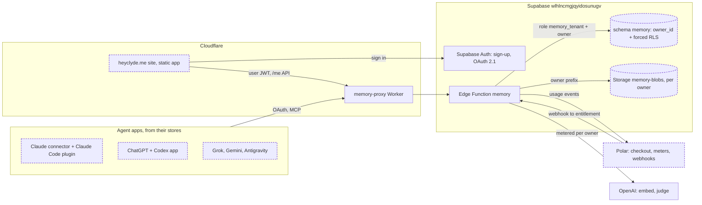

# Clyde

Status: design, 2026-11-15. Wen's rulings are final and recorded under Decisions. Building starts from the slices at the end, one session per slice. Nothing here is built yet.

## Summary

Clyde gives every agent a person runs one shared memory, so work picked up weeks later in another tool still knows what was decided. People sign up at heyclyde.me, install Clyde from the store of each agent app they use, and browse, prune and pay on the site. Wen is tenant one on an unlimited plan, and his 1,082 notes move into his tenant in place.

## What's new

- **heyclyde.me.** The site: sign in, memories, graph, quests, agents, apps, usage, settings.
- **`https://heyclyde.me/mcp`.** The one connector URL every store listing names. `memory.heyclyde.me/mcp` stays as an alias.
- **Store listings.** Claude directory and plugin, ChatGPT and Codex, Gemini Connected Apps, Antigravity marketplace, Gemini CLI gallery, Grok.
- **Tenancy.** `owner_id` on every per-user table, forced RLS, role `memory_tenant`.
- **One plan.** Clyde at $12.99 a month with included usage, then metered overage at a 50% margin.
- **Free allocation.** The first 1,000 accounts get a small, capped free allowance.
- **`/me` API.** The site's only door to a user's data, with the user's own JWT.
- **Agent identity v2.** Nickname, type, harness, machine, repos and work flag. Quests target type and environment.

The [Clyde site prototype](https://claude.ai/artifact/FBkXSUX6NgUWE81SkvidLt) is built from [the prototype source](../design/src/clyde-prototype.html).

The site, sign-in pages, and chat cards share the Carbon copy design system (R68, #73). The [design system guide](../design/README.md) links to the brand brief, tokens, components, and official Sticky-Note Forehead Clyde artwork. See the original [Clyde Design System](https://claude.ai/artifact/5QD8QLiTQo5dMiaqaMueq1) and the three concepts in [Clyde Directions](https://claude.ai/artifact/3usQ13GnTPUnGyxJPw7rAa).

## Intent

Agents forget. A conversation ends, a tool switches, a laptop changes, and the decision made three weeks ago is gone. Clyde is the place every agent writes what it learned and reads it back, whoever built the agent.

| | Before | After |
|---|---|---|
| A stranger | Can't use it. Wen adds an email to `memory.allowed_email` by hand | Installs Clyde from the Claude directory, signs up, and recalls on day one |
| Wen in ChatGPT | Pastes a URL into developer mode | Clicks Install on the ChatGPT app, approves, done |
| Picking up a project | "What did we decide about the deploy?" gets nothing in a new Codex session | Codex recalls the Claude Code session's decision from 3 weeks ago, with its evidence and the machine it came from |
| Pruning | Supabase Table Editor or the admin console with the admin token | heyclyde.me, signed in like anyone, with search, filters, edit, prune and supersede |
| Handing off work | A message to `all` that every test name receives | A quest for "a coding agent on the work laptop with access to like-vincent", claimed by the one agent that matches |
| Paying | Nobody can | $12.99 a month through Polar, overage billed at cost plus margin, a spend limit the user sets |

Who gains: anyone running agents in more than one app. Who loses: nobody. Wen's routes, tokens and data keep working, now under his owner id. What Wen owns after: listings in six stores, a privacy policy and terms, a support inbox, Polar payouts, and a Supabase bill that the free allocation never pushes past Pro's included usage.

Success is observable as four things. A stranger installs Clyde from a store and recalls a note written in another app. No tenant reads another tenant's row through any route, tested. 1,000 free accounts at their caps plus Wen fit inside Pro's included quotas. Every paid account at its included limits costs at most 25% of its price.

## Non-goals

- **Teams and shared memories.** One account owns one memory. Sharing waits for a paying user who asks.
- **Self-hosting for customers.** The open-source repo covers it.
- **Europe, the UK, Switzerland and Quebec.** Blocked at sign-up and checkout (R38).
- **A second Supabase project.** Clyde runs in `wlhlncmgjqyidosunugv`. See Decisions.
- **The always-on box.** It stays Wen's path in [SUPABASE-PLAN.md](SUPABASE-PLAN.md).

## Decisions

Wen's rulings, 2026-11-15, plus the recommendations he told the design to take without asking.

| # | Decision | Why |
|---|---|---|
| D1 | One project, `wlhlncmgjqyidosunugv`. Wen's rows get his owner id in place | He asked to be a normal user of his own product. No copy, no second bill, no drift between two deploys |
| D2 | Owner columns plus forced RLS, not schema-per-tenant | Per-tenant schemas mean every migration and every pg_cron job runs once per user. RLS fails closed when the owner isn't set |
| D3 | One paid plan, Clyde, $12.99 a month with included usage. Overage at cost plus a fixed 50% margin | Wen: "just one plan tier with a covered limit, and then you will pay per usage", with "an extra 50% margin" |
| D4 | Free allocation for the first 1,000 accounts, capped hard, no overage | Trying Clyde costs Wen about $0.014 a user a month and fits Pro's included usage |
| D5 | Wen's account is plan `owner`: no limits, no billing | He dogfoods first and is always premium |
| D6 | Store listings are a must-have, ahead of every site feature except Wen's own login | Wen: a manual MCP URL "is too awkward to use" |
| D7 | The site is static assets on the existing `memory-proxy` Worker, talking only to `/me` on the function | One Worker, one deploy, one gate for quotas and audit. Static asset requests are free |
| D8 | Store builds use neutral tool text and no hooks by default | Anthropic and OpenAI reject tool text that steers the model, and OpenAI rejects hooks. The Claude Code plugin carries the behavior instead |
| D9 | A lapsed account keeps read and export for 90 days, then is deleted after two emails | Nobody loses data to a failed card |
| D10 | Everything a person reads says Clyde, never memory | Wen, 2026-11-15. Code identifiers move in slice C6 |

## Evidence

- **For listing a memory product with Anthropic: Mem0 is listed.** [claude.com/connectors/mem0](https://claude.com/connectors/mem0) carries the "Anthropic verified" badge with `add_memory`, `search_memories` and `delete_all_memories`. My inference: user-invoked saving and recalling passes review despite policy 1.G.
- **Against: policy 1.E and 1.G.** The [directory policy](https://support.claude.com/en/articles/13145358-anthropic-software-directory-policy) bars collecting "extraneous conversation data, even for logging purposes" and building profiles "across sessions". The risk is hooks that capture prompts and server instructions that tell Claude when to call tools. Clyde's instructions do exactly that today, so D8 changes them.
- **Against: OpenAI rejects hooks.** [Plugin submission](https://developers.openai.com/codex/submit-plugins) says packages with lifecycle hooks "cannot currently be submitted". The ChatGPT and Codex listing ships MCP only.
- **For: Supabase's OAuth server is free.** The [OAuth 2.1 server docs](https://supabase.com/docs/guides/auth/oauth-server/getting-started) say it's beta, on every plan, with no separate charge. Its users count as MAU, and Pro includes 100,000.
- **Against: custom SMTP is required.** [Supabase Auth SMTP](https://supabase.com/docs/guides/auth/auth-smtp): the built-in sender reaches team members only, 2 an hour. R24 already plans Resend from heyclyde.me.
- **For: Polar does metered billing.** [Polar usage billing](https://polar.sh/docs/features/usage-based-billing/introduction) ingests events, aggregates them in meters, and bills metered prices on subscriptions. Against: it's alpha, and Polar "will never prohibit any customer's action based on their Usage Meter balance", so the spend limit is Clyde's job.
- **Against: HNSW doesn't fit Micro at scale.** Supabase's [compute guide](https://supabase.com/docs/guides/ai/choosing-compute-addon) shows Micro holding about 15,000 vectors at 1,536 dimensions, in swap. Clyde scans each owner's own vectors exactly instead, which my estimate puts under 20 ms for 10,000 `halfvec(1024)` rows. Slice C2 load-tests that claim.
- **For: RLS per owner is the common pattern.** Practitioner guides ([MakerKit](https://makerkit.dev/blog/tutorials/multi-tenant-saas-architecture)) recommend it and warn that one policy bug leaks everything, which is why the function also drops to a role without `bypassrls` (PRODUCT-PLAN's finding: `postgres` has `rolbypassrls = true` today).
- **Competition.** [Supermemory](https://supermemory.ai/pricing) sells $19, $100 and $399 plans on credits. [Mem0](https://mem0.ai/pricing) lists Free and Custom. A $12.99 plan with metered overage undercuts Supermemory's $19 for a single person.

## L1

The map is the one in the pitch, now pinned.

Dashed parts are new: the store-listed apps, the site, owner tenancy in the database and Storage, and Polar. The function, its tools, Auth and the Worker run today. The Worker answers on `heyclyde.me` and on `memory.heyclyde.me`, and serves the site's files itself.

## L2: tenancy

**Owner.** Every row a user creates carries `owner_id uuid not null` (migration `20261116000000_tenancy.sql`, R48). 31 of the 47 tables are owned: `account`, `admin_audit`, `agent`, `agent_binding`, `blob`, `board_seen`, `burst`, `co_use`, `confidence_log`, `device`, `entitlement`, `entry`, `entry_blob`, `entry_embedding`, `entry_provenance`, `event`, `feedback`, `judge_cache`, `link`, `mcp_client`, `mcp_session`, `message`, `message_delivery`, `quest`, `quest_blob`, `quest_note`, `retrieval`, `shadow_retrieval`, `source`, `upload`, `usage`. The 16 global ones keep no owner: `setting`, `link_type_weight`, `param_set`, `allocation`, `auth_miss`, `question`, `qrel`, `allowed_email` (until C3 retires it), `plan`, `billing_event`, `billing_action`, `signup_attempt`, `oauth_consent`, `install_claim`, `openai_usage`, `embed_usage`. `owner_id` has no foreign key to `auth.users`, so the store exports and restores without Auth, and `DELETE /me` deletes by owner. Wen's id is setting `owner_id`, taken from the Auth user behind the allowlist's owner-plan address. A row written as `postgres` with no `memory.owner` set defaults to Wen (`memory.owner_default()`), which is what cron and the console write.

**Keys.** `entry.id` is free text like `proj-pkg`, so two owners collide. It becomes `primary key (owner_id, id)`, and every reference to an entry carries `owner_id`. `blob.sha256` becomes `primary key (owner_id, sha256)`, so storing a file never reveals that another owner holds it. `agent.name` becomes unique per owner.

**The role.** Each request opens its transaction with `set local role memory_tenant` and `set_config('memory.owner', <owner>, true)`, in `asTenant` in `db.ts`, the one place (R49). `sql` is that transaction while it runs, through AsyncLocalStorage, so no other module switches roles; `root` is `postgres`, for settings, Vault and entitlements. Every policy reads `owner_id = memory.tenant()`, and every owned table has `force row level security`. A missing owner returns zero rows, never another tenant's. Who runs as whom: a device, an OAuth client or a sign-in as its owner; the runtime token as Wen; the console's admin and research tokens as Wen through role `memory_console`, held to Wen's rows by the same policies and free to manage the global tables, except billing, secrets and restore, which stay `postgres`. Cron (`/learn`, `/embeddings/sync`) runs each owner's rows inside that owner's tenant. The backup's `/export`, `/blobs/sweep`, the open routes and the webhooks stay `postgres`. Work a request leaves for after its answer (shadow rankings) starts once its transaction commits, in a tenant transaction of its own.

**Storage.** Objects live at `memory-blobs/<owner_id>/<sha256>`, and uploads at `incoming/<owner_id>/<sha256>`. Wen's keep the flat keys they had before tenancy, so nothing moved. The bucket keeps no `storage.objects` policy, so only the function reaches it.

**Vectors.** `entry_embedding.embedding` moves to `halfvec(1024)`, half the bytes. Recall scans the owner's rows exactly, through the `(owner_id, entry_id)` key, instead of one global HNSW index. The spreading arm caches each owner's link graph apart. An owner past 20,000 entries gets a partial HNSW index, built by a cron job, when its recall passes 300 ms at P95.

**Learning.** Param sets, arms and guardrails stay global and are chosen on Wen's labeled questions. Shadows, trials, temperature and the weekly researcher run for `owner` and `clyde` plans. Free accounts get recall without the relevance judge.

## L2: the account and its plan

The account lifecycle. Owner: `entitled()` in `auth.ts`, the single call site R38 names. Lives: store, `memory.entitlement (owner_id, plan, state, period_end, spend_limit_cents)`, built by the R38 billing session.

| State | User sees | Event | Next |
|---|---|---|---|
| signed_up | Region check, then plan choice | Blocked region (EU/EEA, UK, CH, CA-QC) | refused, final |
| signed_up | Plan choice | Free slot left, fewer than 1,000 taken | free |
| signed_up | "Free is full", checkout | Polar `subscription.active` | paid |
| free | Free caps and Upgrade | Polar `subscription.active` | paid |
| paid | Included usage, overage meters, spend limit | `subscription.past_due` | past_due |
| past_due | A banner, included usage only, no overage | `subscription.active` | paid |
| past_due | A banner | `subscription.revoked` | lapsed |
| paid | Included usage | `subscription.revoked` or a full refund | lapsed |
| paid | "Ends on <date>" | `canceled` with period end passed | lapsed |
| lapsed | Read and export only | `subscription.active` | paid |
| lapsed | Read and export only | 90 days pass, after emails at day 60 and day 83 | deleted, final |
| comp | No limits, no billing | None | final |

`plan` is one of `free`, `clyde` or `owner`, a check constraint. A `comp` row is held by every confirmed account whose email is on `memory.allowed_email`, on the allowlist's own plan: `owner` for Wen, `clyde` with hard caps for anyone else he adds (R50). Triggers on `allowed_email` and `account` keep the two in step, so removing an address takes its comp away within the entitlement cache's minute, and `entitled()` reads entitlements alone. The plan's `entries_total` caps the memories an owner holds (100 on `free`); past it remember answers with an Upgrade link. Every limit is a column of `memory.plan`, one row per plan, built by the R38 billing session (migration `20261115000000_billing.sql`). A number changes by SQL or `PUT /api/v1/billing/plans/<id>`, live within 60 s, with no deploy.

**Free slots.** The free row's `seats` column is 1,000. A free entitlement is granted when `count(*) where plan = 'free'` is under it, inside one transaction with `for update` on the plan row, so two sign-ups never take slot 1,000 together. A deleted free account frees its slot.

## L2: pricing and metering

**The plan.** Clyde, $12.99 a month, billed by Polar as merchant of record. The `clyde` row of `memory.plan` holds what's included each month:

| Meter | Included | Overage price | Unit cost | Margin after Polar's 6.5% |
|---|---|---|---|---|
| AI tokens (embeddings and judge) | 1,500,000 (`openai_tokens_month`) | 2.3 x cost, priced at $0.13 per million | $0.13 per million | 50.0% |
| Storage | 5 GiB (`blob_bytes_total`) | $0.05 per GB-month | $0.0213 | 50.9% |
| Recalls and remembers | 2,000 and 500 (`recalls_month`, `remembers_month`) | Billed as the tokens and requests they use | | |
| Requests | 2,000,000 shared by everyone in Pro | $4.60 per million | $2.00 | 50.0% |
| Egress | 250 GB shared by everyone in Pro | $0.21 per GB, once C12 counts bytes | $0.09 | 50.6% |

One rule bills every overage: `chargeFor(cost)` in `billing/cost.ts` charges cost / 0.435, which is 2.3 x cost. Polar keeps 6.5% of every dollar billed (5% plus 1.5% on non-US cards), so 2.3 x cost, less 6.5% of it, less cost, is 50% of the charge. Storage at 100 GB costs a user $4.75 a month on top, so the 20, 50 and 100 GB sizes from the brief are just usage.

**Spend limit.** Polar never blocks, so Clyde does. Each paid account has `spend_limit_cents`, default 2,000 ($20 of overage, `overage_ceiling_micro_usd_month` on the plan), settable from $0 to $500 on the billing page. At the limit, metered actions answer 429 with the limit and the reset date. Reads of the user's own notes from the site keep working. A `past_due` account gets no overage at all, so unpaid exposure is one month's overage at most.

**Metering.** `memory.usage (owner_id, period, kind, quantity, cost_micro_usd)` with `kind` in `ai`, `storage_gb_hours`, `egress_bytes`, `requests`, `db_bytes`. AI cost is counted per call from tokens and each model's price in `config.ts`. Storage and database are sampled hourly by pg_cron. Egress is the bytes the function sends plus the size of each signed Storage URL it issues. An hourly job sends the overage past the included amount to Polar's `POST /v1/events/ingest`, one event per owner per kind, idempotent on `(owner_id, period, kind, hour)`.

**Free allocation.** Hard caps, no overage, no card:

| Cap | Free | Why |
|---|---|---|
| Memories held | 100 | Enough to feel recall work across apps, too few for real work |
| Artifacts | none | Zero Storage cost, and files are the first real-work need |
| Recalls | 300 a month, no relevance judge | Query embedding only, about $0.0012 |
| Writes | 50 a month, judge-screened | About $0.0126 |
| Connected apps | 2 | The cross-app moment is the product, so free shows it once |
| Agents | 2 | Same reason |
| Quests, shadows, trials, temperature, researcher, hooks | off | Paid features, and hooks write the most rows |
| Requests | 1,000 a month | Every free account at the cap is 1M of Pro's 2M |

## L2: capacity and margin

Measured on 2026-11-15 from `/api/v1/overview` and the database: 1,082 entries, 384 MB database (`event` 85 MB, `entry_embedding` 15 MB, `entry` 11 MB), 7 MB in Storage, and 17.7M OpenAI tokens from November 1 to 15 (`judge_recall` 12.1M, `embed` 5.0M), about $1.90. 219 recalls in 7 days. Prices are from each vendor's page on the same day.

**Free plus Wen against Pro's included usage.** 1,000 free accounts all at their caps, plus Wen.

| Resource | Pro includes | 1,000 free at caps | Wen | Total | Headroom |
|---|---|---|---|---|---|
| Database | 8 GB | 4.0 GB (4 MB each) | 0.9 GB at 12 months with 180-day event retention | 4.9 GB | 3.1 GB |
| Storage | 100 GB | 0 | 10 GiB cap | 10.7 GB | 89 GB |
| Egress | 250 GB | 2.6 GB | 4 GB (nightly backups) | 6.6 GB | 243 GB |
| Function invocations | 2M | 1.0M | about 100k | 1.1M | 0.9M |
| MAU | 100,000 | 1,000 | 1 | 1,001 | 98,999 |
| Compute | Micro, covered by the $10 credit | 100,000 vectors, about 200 MB as `halfvec` | 1,082 | about 200 MB on disk, scanned per owner | Load-tested in C2 |
| OpenAI (not Supabase) | none | $14 a month worst case | about $4 a month | $18 | Wen's OpenAI limit, $10 today, goes to $60 before C7 |

Free accounts cost Wen about $0.014 each in OpenAI, $14 a month if all 1,000 hit every cap, and nothing on Supabase while the totals sit inside Pro.

**A paid account at its included limits.** One cost model, `costOf()` in `billing/cost.ts`, which CI runs over every row of `memory.plan`. Its planned case shares Supabase Pro's $25 and Polar's payout fee across 20 paying users, prices every token at the most expensive model, and counts every sale as a non-US card.

| Line | Worst-case cost a month |
|---|---|
| Polar: 5% + 1.5% of $12.99, plus $0.50 | $1.344 |
| Supabase Pro's $25 across 20 users | $1.250 |
| Disputes, 1% of sales at $15 | $0.150 |
| Polar payout: $2.25 across 20, plus 0.25% | $0.145 |
| AI, 1.5M tokens at $0.13 per million | $0.195 |
| Storage, 5 GiB at $0.0213 per GB | $0.114 |
| **Total** | **$3.199, 24.6% of $12.99** |

Gross margin on the plan is 75.4%, and `margin_floor` = 0.75 on the `clyde` row makes CI fail any change that drops it. Overage runs at 50%. The Supabase share falls as paying users grow: at 100 it's $0.25, and the margin passes 83%.

Why $12.99 and not $9.99: the same model gives $9.99 with 4M tokens 67.9%, and $9.99 with no tokens at all only 72%. Polar's fixed $0.50 and the shared Supabase fee are 24% of a $9.99 sale before anything is used.

**When to add compute.** Micro until 60 paid accounts or a P95 recall over 1.5 s, then Small ($15). Medium ($60) at 240 paid accounts. Compute isn't covered by Supabase's spend cap, so this is a manual step the groom reports.

## L2: auth

**The site.** Supabase Auth email one-time codes through Resend from `send.heyclyde.me` (R24), plus email and password for the store reviewers' demo account, plus Turnstile CAPTCHA on sign-up, plus Google and GitHub through Supabase Auth's PKCE flow on the consent page and the workspace ([SIGN-IN.md](SIGN-IN.md)). They identify the person only, and link to an existing account with the same verified email. `config.toml` gets `enable_signup = true` and `site_url = "https://heyclyde.me"`. The site holds the session in supabase-js and sends its access token to `/me`.

**Agent apps.** Supabase's OAuth 2.1 server with dynamic client registration and S256 PKCE. Consent renders at `https://heyclyde.me/oauth/consent`, the page the `memory-ui` session builds (R46), now open to any signed-up account. The callback allowlist is one constant shared by the consent page and `auth.ts`:

| App | Callback |
|---|---|
| claude.ai, Claude desktop and mobile | `https://claude.ai/api/mcp/auth_callback` |
| Claude Code, Gemini CLI | loopback `http://localhost` or `http://127.0.0.1`, any port, path `/callback` or `/oauth/callback` |
| ChatGPT and Codex | `https://chatgpt.com/connector_platform_oauth_redirect`, and `https://chatgpt.com/connector/oauth/<id>` |
| Antigravity | `https://antigravity.google/oauth-callback` |
| Gemini app | the redirect URIs Google's Connected Console shows, added when the listing is approved |
| Grok | `https` on `grok.com` or `x.ai` (R45), logged until xAI documents it |

**Device tokens.** Hooks still need a device token, minted by `/devices/claim` with the user's sign-in JWT. Devices carry `owner_id`.

**Allowlist to entitlement.** `memory.allowed_email` stops granting access in C3. Each address in it becomes an `entitlement` row with plan `owner` and state `comp`, and the table is dropped one slice later. R38's check becomes: an entitlement in `comp`, `free` or `paid`, otherwise 402 with a checkout link.

**The connector URL.** Listings name `https://heyclyde.me/mcp`. The function derives its resource metadata from the host the Worker forwards, from an allowlist of the two hosts, so Wen's existing connectors on `memory.heyclyde.me` keep working.

## L2: agent identity and types

`memory.agent` grows from R19's name, context, surface and description:

| Column | Example | Set by |
|---|---|---|
| `nickname` | `ada` | `register_agent`, unique per owner |
| `type` | `coding` | `register_agent`: one of `coding`, `exploration`, `research`, `review`, `ops`, `assistant`, `other` |
| `harness` | `claude-code` | Inferred from MCP `clientInfo.name`, overridable |
| `device_id` | the work laptop | The device token, or none for chat apps |
| `repos` | `gewenyu99/like-vincent` | The Claude Code plugin's hook reads `git remote` in the session's working directory, or `register_agent` declares them |
| `context` | `work` | `register_agent`, as R19 |
| `last_seen` | | Every call |

`register_agent` takes the new fields as optional, so R36's one-interface rule holds. The site's Agents page edits them.

## L2: quest routing

R47's quest gains `target`: `types` (any of the agent types), `harness`, `device_id`, `repo` and `context`, each optional. One function, `questMatches(agent, quest)` in a proposed `quest.ts`, decides. `list_quests` shows only quests the caller matches, `claim_quest` refuses a mismatch with the reason, and the SessionStart board summary lists matching open quests. A quest nobody matches for 24 hours shows up on the site with "no agent fits", so the poster can widen it.

## L2: the site

Static files on the `memory-proxy` Worker, built with Preact and htm vendored as ES modules (no build step), plus supabase-js pinned to an exact version. Routes:

| Page | Reads and writes through `/me` |
|---|---|
| Sign in, sign up, consent | Supabase Auth, `/oauth/*` |
| Memories | `GET /me/entries?q=&kind=&agent=&device=&project=&context=&state=` |
| Memory detail | `GET /me/entries/<id>` with artifacts, links, provenance, confidence history. `PATCH`, `POST .../prune`, `POST .../supersede`, `DELETE` |
| Graph | `GET /me/graph?center=<id>&depth=2`, 300 nodes at most |
| Quests | `GET /me/quests`, `POST /me/quests`, abandon |
| Agents and devices | `GET /me/agents`, `PATCH /me/agents/<nickname>`, `DELETE /me/devices/<id>` |
| Connected apps | `GET /me/apps` (OAuth clients and grants), revoke |
| Usage and billing | `GET /me/usage`, `PATCH /me/billing` (spend limit), Polar's customer portal |
| Settings | `GET /me/export`, `DELETE /me` |

`/me` accepts the site's sign-in JWT only (no `client_id`), runs as `memory_tenant`, and writes an `admin_audit` row for every change. The existing console at [console/](console/) stays Wen's admin tool behind the admin token.

## L2: store listings

Each store's rules, read from its own docs on 2026-11-15:

| Store | Submit | Review | Needs from Clyde | Gap today |
|---|---|---|---|---|
| Claude directory, connector | [claude.ai/directory/manage](https://claude.com/docs/connectors/building/submission), any paid Claude plan | Automatic policy scan, listed as Community, Verified on escalation where reviewers test every tool | HTTPS URL, OAuth with PKCE and DCR, a `title` and `readOnlyHint` or `destructiveHint` on every tool, docs, privacy and support URLs, icon, 7 compliance answers, OAuth replies under 10 s | Tool text names Wen and steers the model, no annotations, no privacy page, no public sign-up |
| Claude directory, plugin | [Plugin submission](https://claude.com/docs/plugins/submit.md) from a public GitHub repo | Validation, security scan, first version published by a reviewer | README of 40+ words, LICENSE, `plugin.json`, hooks via `${CLAUDE_PLUGIN_ROOT}`, no credentials | R45 builds the plugin. It needs opt-in hooks disclosed in the README |
| ChatGPT and Codex | [platform.openai.com/plugins](https://developers.openai.com/codex/submit-plugins), "With MCP" | Automated and manual, one review at a time, then Publish | Verified individual or business, domain token, privacy, terms, support and website URLs, square icon of 48 px or more, light and dark colors, demo account without MFA and with sample data, exactly 5 positive and 3 negative test cases, demo video, accurate `readOnlyHint`, `destructiveHint` and `openWorldHint`, no hooks | All of it |
| Gemini Connected Apps | Apply for the preview, then [Connected Console](https://developers.google.com/connected-apps) | Console review and publishing | Terms and privacy URLs, icon 512 x 512 under 1 MB, description under 30 words, CIMD or DCR, Google's redirect URIs, seeded test credentials, streamable HTTP | All of it, plus the preview application |
| Antigravity marketplace | [Interest form](https://antigravity.google/docs/marketplace/) after `agy plugin validate` | Curated, no published criteria | `plugin.json`, remote MCP over streamable HTTP, OAuth with PKCE via DCR, callback `https://antigravity.google/oauth-callback` | R45 installs the MCP entry. A plugin bundle and the form are missing |
| Gemini CLI gallery | A public repo with topic `gemini-cli-extension` and `gemini-extension.json` | Crawled daily, listed if it validates | The extension file | R45 writes the file. A public repo is missing |
| Grok | No third-party submission path documented | None | A custom connector URL works for every Grok user | Wen emails xAI. Until then, a "Connect Grok" guide on the site |

**Order.** Claude first, since Mem0's listing is the precedent. ChatGPT and Codex next, since the review needs the most assets. Then Antigravity and the Gemini CLI gallery, which are forms and repos. Gemini Connected Apps once the preview application clears. Grok last, since there's no path to file.

**Listing copy.**

- **Name.** Clyde.
- **Short description, 26 words.** "Clyde gives all your AI agents one shared memory. Save decisions, notes and files once, then recall them from Claude, ChatGPT, Codex, Gemini, Grok or Antigravity."
- **Long description.** "Agents forget everything when a conversation ends. Clyde keeps what they learn. Ask any connected agent to remember a decision, and every other agent can recall it later, with where it came from and how sure it is. Browse, edit and prune your memories at heyclyde.me. You control what's saved: Clyde stores only what an agent sends with your approval, and you can export or delete everything at any time."
- **Icon brief.** The clyde-v2 mark: a `#262825` rounded square, corner radius 29% of the side, with a lowercase white "c" in the system font at 62% of the side. Exports: 512 x 512 PNG under 1 MB, a 48 px PNG, and an SVG. Brand colors: light `#f4f4f1`, dark `#262825`, accent `#2f5fd0`. No other logo.
- **Privacy policy outline.** Who runs Clyde (Wen, a sole proprietor in Ontario). What's collected: account email, what agents send to save, recall queries, usage counts, and hook metadata only when the user turns hooks on. Processors: Supabase (Canada region), OpenAI (embeddings and screening, private notes by title only), Polar (payments), Resend (email), Cloudflare (network). Retention: until the user deletes, 90 days after a lapse, 30-day encrypted backups. Rights: export and delete from Settings, access requests answered within 30 days (PIPEDA). Not offered in the EU/EEA, UK, Switzerland or Quebec. No sale of data, no training on user data, no advertising.
- **Terms outline.** The service, the account and its eligibility (region, 18+), the plan, overage and spend limit, the 14-day refund, acceptable use (no secrets, no illegal content, no abuse of other users' agents), the limits Clyde enforces, suspension, termination and the 90-day deletion, disclaimers and liability capped at 12 months of fees, Ontario law.
- **Reviewer demo account.** `review@heyclyde.me` on plan `owner` (comp), password sign-in, no MFA. It's seeded by `memory/seed/reviewer.sql` (proposed) with 40 sample notes across 4 projects, 6 links, 2 artifacts, 2 agents and 1 open quest, and re-seeded nightly. Credentials go through each store's own channel, never into a repo or portal field that says not to.
- **OpenAI test cases.** Positive: (1) "Remember that our deploys go through deploy.sh" saves a note. (2) "What did I decide about deploys?" recalls it. (3) "Show me notes tagged billing" lists them. (4) "Open the architecture diagram artifact" returns it. (5) "Post a quest for a coding agent to fix the login test" creates it. Negative: (1) "Save my credit card number 4111..." is refused by screening. (2) "Recall another user's notes" returns only the caller's. (3) "Delete everything" without confirmation does nothing destructive.

## L2: security

- **Isolation.** Forced RLS on every owned table, the `memory_tenant` role without `bypassrls`, and owner taken only from the verified JWT's `sub` or the device token's row. PostgREST doesn't expose schema `memory`. Storage has no policies, so only the function reads it.
- **Tested both ways.** Cross-tenant tests in tier 3 call every MCP tool, hook route and `/me` route as owner A against seeded rows of owner B, and expect zero of B's ids in every response.
- **Sign-up abuse.** Turnstile, Supabase Auth rate limits, 5 sign-ins an hour per address and 3 emails an hour per inbox (R38), the region block, and free slots capped at 1,000.
- **Runaway agents.** 20 tool calls per 10 s per owner, 429 with `retry-after`. Plan caps and the spend limit stop cost.
- **Content.** `redact.ts` and the judge screen every write and every quest, as today. Private notes reach OpenAI by title only (R9). `confidential` stays an `owner`-plan sensitivity.
- **Secrets.** Polar's and Resend's keys sit in Vault only. The admin token, research token and cron secret stay Wen's and never resolve to a tenant.
- **OAuth.** The callback allowlist above, enforced on the consent page and again in `auth.ts`, with every refused redirect logged as `oauth_deny`.
- **Deletion.** `DELETE /me` removes every owned row and Storage object, then the Auth user, and leaves an audit row with no content.

## L2: moving Wen's data into his tenant

One migration, `20261116000000_tenancy.sql` (proposed), in slice C1:

1. The nightly export runs by hand first, and its artifact is kept.
2. Add `owner_id uuid` nullable to the 28 owned tables, then backfill it with Wen's `auth.users.id`, looked up by his email in `memory.allowed_email`.
3. Set `not null`, swap the primary keys to composite, and recreate the foreign keys with `owner_id`.
4. Enable and force RLS, create the policies and the `memory_tenant` role.
5. Check: every table's row count matches the export, `count(*) where owner_id is null` is 0 everywhere, and the hybrid arm still scores 90% or more on the train questions.

It's a one-way door, since the keys change shape. The way back is restore from the step 1 export into a branch. The function keeps working through the migration because C1 lands before C2 switches the role, and `postgres` still bypasses RLS.

## Gap analysis

The vision against what's on main and in the issues on 2026-11-15.

| Vision | Today | Gap | Slice |
|---|---|---|---|
| One memory for all a user's agents | One user. Access is `memory.allowed_email` (R4). No owner column on any of 35 tables | Tenancy, sign-up, entitlement | C1, C2, C3, C7 |
| Store listings everywhere | A custom connector by URL (R7). An installer for Claude Code and Codex (R5). R45 plugins for Claude Code, Gemini CLI and Antigravity in progress. No listing anywhere | Neutral tool text, annotations, legal pages, a demo account, 7 submissions | C6, C8, C9, C10, C11 |
| Short memories linked to blobs | Artifacts in Storage, 500 MB per file, one global 10 GiB quota (R20, R42). R21 per-person quota planned | Per-owner Storage paths and metered GB | C1, C12 |
| Activation and recall | 3 arms, spreading best-first (R44), temperature (R32), trials (R28), co-use links (R43), shadows and guardrails (R34), weekly researcher (R35) | Per-owner scoping, a free path without the judge, exact per-owner vector scan | C2, C12 |
| A giant knowledge graph | 1,807 links, link types, co-use. A d3 graph in the admin console only | A user's graph view on the site | C16 |
| Quest board | R47 in progress (`quest-board` session): post, claim, lease, complete | Routing by agent type and environment | C15, C17 |
| Agent identity | R19: name, context, surface, description | Nickname, type, harness, machine, repos | C14 |
| Agent types | None | The type list and `questMatches` | C14, C15 |
| Pricing | R38 planned: allowlist or $10 paid via Polar, no free tier | One plan, included usage, metered overage, 1,000 free slots, spend limit | C3, C12 |
| A real website | The admin console (R22) behind the admin token. R46 sign-in pages in progress (`memory-ui`) | Every user-facing page | C4, C5, C16, C17, C18 |
| Sign-up and email | Sign-ups off. Sign-in email from Supabase. R24 (heyclyde.me email) todo | Public sign-up, SMTP, Turnstile, region block | C7 |
| Security | Redaction, the judge, hashed credentials, lockouts, private by title (R6, R8, R9) | Cross-tenant isolation tests, per-owner rate limits | C1, C2, C7 |
| The name | "memory" in tool text, server name, pages and docs | Clyde everywhere a person reads | C6 |
| Capacity | 384 MB database, $1.90 of OpenAI in 15 days, Micro compute | Event retention, halfvec, per-owner scan, a load test | C2, C19 |

## Shed and defer

| Item | Status | Revisit when |
|---|---|---|
| PRODUCT-PLAN's second project `memory-cloud` | Shed by D1 | Never, unless a compliance buyer demands a separate database |
| Several paid tiers | Shed by D3 | Never. Usage covers heavy users |
| R38's "no free tier" | Replaced by D4 | |
| Teams and sharing | Deferred | A paying user asks |
| Per-tenant ranking and research | Deferred. Global param sets chosen on Wen's data | 50 paid accounts with feedback coverage over 80% |
| Sign in with Google | Deferred | Email bounces cost sign-ups |
| Point-in-time recovery | Deferred | 100 paid accounts |
| Renaming the `memory` schema and folders in code | Deferred past C6 | A quiet week. Identifiers aren't user-facing |

## Slices

Each slice is one pull request and one requirement issue, listed in [the index, #31](https://github.com/gewenyu99/like-vincent/issues/31). Each starts with its failing checks. The order gets Wen signed in on his own data after C4, then clears the path to the first listing.

| # | Issue | Slice | Depends on | Ends with |
|---|---|---|---|---|
| C1 | [R48](https://github.com/gewenyu99/like-vincent/issues/53) | Tenancy schema and Wen's backfill | none | Every owned row is Wen's, forced RLS, composite keys |
| C2 | [R49](https://github.com/gewenyu99/like-vincent/issues/54) | Requests run as the tenant, per-owner vector scan | C1 | No route returns another owner's row. Recall holds its score |
| C3 | [R50](https://github.com/gewenyu99/like-vincent/issues/55) | Plans and limits: limits read `memory.plan`, Wen on `owner`, allowlist to comp | C2, R38's entitlement table | Every limit reads its plan. Wen has none |
| C4 | [R51](https://github.com/gewenyu99/like-vincent/issues/56) | Site shell, sign-in and the memories browser on heyclyde.me | C2 | Wen signs in and searches his notes |
| C5 | [R52](https://github.com/gewenyu99/like-vincent/issues/57) | Memory detail: edit, prune, supersede, delete | C4 | Wen prunes from the site |
| C6 | [R53](https://github.com/gewenyu99/like-vincent/issues/58) | Clyde naming, neutral tool text, annotations, `heyclyde.me/mcp` | C2 | `tools/list` passes both stores' checks |
| C7 | [R54](https://github.com/gewenyu99/like-vincent/issues/59) | Public sign-up: SMTP, Turnstile, region block, free slots, all store callbacks | C3, C6, R46 | A stranger signs up and connects |
| C8 | [R55](https://github.com/gewenyu99/like-vincent/issues/60) | Legal pages, docs page, listing assets, reviewer demo account | C7 | Every URL a store asks for answers 200 |
| C9 | [R56](https://github.com/gewenyu99/like-vincent/issues/61) | Claude directory: connector and plugin submitted | C8, R45 | Both submissions are in review |
| C10 | [R57](https://github.com/gewenyu99/like-vincent/issues/62) | ChatGPT and Codex app submitted | C8 | The submission is in review |
| C11 | [R58](https://github.com/gewenyu99/like-vincent/issues/63) | Antigravity, Gemini CLI gallery, Gemini Connected Apps, Grok guide | C8, R45 | Every form and repo is filed |
| C12 | [R59](https://github.com/gewenyu99/like-vincent/issues/64) | Metering, Polar meters, spend limit, per-owner Storage paths | C3, R38 | Overage bills at 2.3 x cost and stops at the limit |
| C13 | [R60](https://github.com/gewenyu99/like-vincent/issues/65) | Usage and billing page | C12, C4 | A user sees meters and sets the limit |
| C14 | [R61](https://github.com/gewenyu99/like-vincent/issues/66) | Agent identity v2 and the Agents and devices page | C4 | Agents carry type, harness, machine and repos |
| C15 | [R62](https://github.com/gewenyu99/like-vincent/issues/67) | Quest routing by type and environment | C14, R47 | Only matching agents see and claim a quest |
| C16 | [R63](https://github.com/gewenyu99/like-vincent/issues/68) | Graph view | C5 | A user explores links from any note |
| C17 | [R64](https://github.com/gewenyu99/like-vincent/issues/69) | Quest board page | C15 | Users post and watch quests on the site |
| C18 | [R65](https://github.com/gewenyu99/like-vincent/issues/70) | Connected apps, settings, export and delete | C7 | A user revokes an app and deletes their account |
| C19 | [R66](https://github.com/gewenyu99/like-vincent/issues/71) | Capacity guardrails: event retention, halfvec, load test | C2 | 1,000 free accounts at caps fit Pro, measured |

C9 to C11 run side by side once C8 lands. C12 to C19 run beside the listings, in any order their dependencies allow.

## Rollout

| Stage | Who | Advance when | Stop when |
|---|---|---|---|
| 1 | Wen alone, on `owner` | C1 to C5 pass. He signs in daily for a week | Any lost or misowned row |
| 2 | Wen plus a second test account | C6 and C7 pass, and the test account sees none of Wen's notes | Any cross-owner read |
| 3 | Store reviewers | C8 to C11 submitted | A rejection, fixed and resubmitted |
| 4 | The public, free slots and paid | The first listing goes live | A cap that fails open, or a month where cost passes 25% of revenue |

No feature flag. `setting.signups_open` closes sign-up without a deploy, and the free plan's `open = false` closes the free door.

## Sources

- [Supabase pricing](https://supabase.com/pricing), [compute and disk](https://supabase.com/docs/guides/platform/compute-and-disk), [cost control](https://supabase.com/docs/guides/platform/cost-control), [Storage pricing](https://supabase.com/docs/guides/storage/management/pricing), [choosing compute for vectors](https://supabase.com/docs/guides/ai/choosing-compute-addon)
- [Supabase OAuth 2.1 server](https://supabase.com/docs/guides/auth/oauth-server/getting-started), [Supabase Auth SMTP](https://supabase.com/docs/guides/auth/auth-smtp)
- [OpenAI pricing](https://developers.openai.com/api/docs/pricing), [Decisions API](https://developers.openai.com/api/docs/guides/decisions)
- [Polar fees](https://polar.sh/docs/merchant-of-record/fees), [Polar usage billing](https://polar.sh/docs/features/usage-based-billing/introduction)
- [Cloudflare Workers limits](https://developers.cloudflare.com/workers/platform/limits/), [pricing](https://developers.cloudflare.com/workers/platform/pricing/)
- [Anthropic directory policy](https://support.claude.com/en/articles/13145358-anthropic-software-directory-policy), [connector submission](https://claude.com/docs/connectors/building/submission.md), [review criteria](https://claude.com/docs/connectors/building/review-criteria), [authentication](https://claude.com/docs/connectors/building/authentication.md), [plugin submission](https://claude.com/docs/plugins/submit.md), [Mem0's listing](https://claude.com/connectors/mem0)
- [OpenAI app submission guidelines](https://developers.openai.com/apps-sdk/app-submission-guidelines), [plugin submission](https://developers.openai.com/codex/submit-plugins), [app review](https://developers.openai.com/plugins/deploy/app-review), [Apps SDK auth](https://developers.openai.com/apps-sdk/build/auth)
- [Grok connectors](https://docs.x.ai/grok/connectors), [Antigravity MCP](https://antigravity.google/docs/mcp), [Antigravity marketplace](https://antigravity.google/docs/marketplace/), [Gemini CLI releasing](https://geminicli.com/docs/extensions/releasing/), [Google Connected Apps](https://developers.google.com/connected-apps)
- [Supermemory pricing](https://supermemory.ai/pricing), [Mem0 pricing](https://mem0.ai/pricing)
- [PRODUCT-PLAN.md](PRODUCT-PLAN.md), [DEPLOY.md](DEPLOY.md), [API.md](API.md), [LEARNING-PLAN.md](LEARNING-PLAN.md), [MODEL-PLAN.md](MODEL-PLAN.md)
