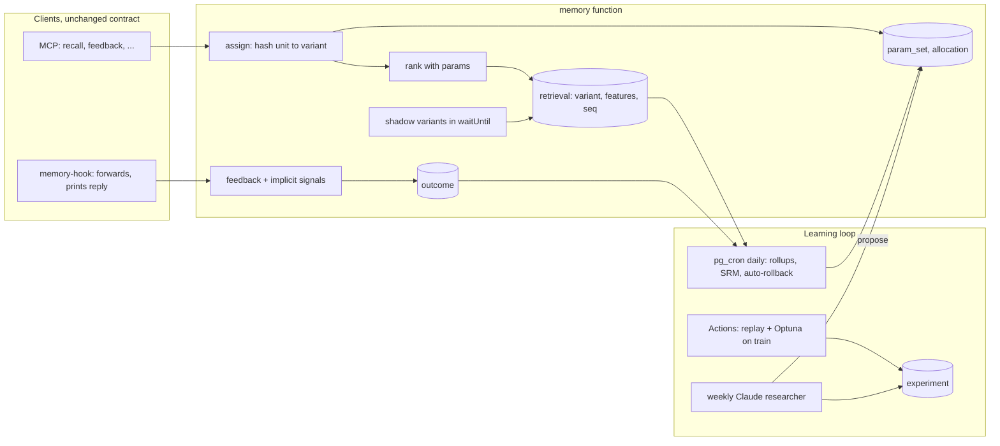

# memory's learning loop

The plan for R32 (#36, age and temperature), R33 (#37, feedback), R34 (#38, variants), R35 (#39, the researcher), R36 (#40, one interface) and R31 (#35, self-updating clients). MODEL-PLAN.md covers kinds and trials. The issues' acceptance criteria are the contract. This file carries the design they don't.

## Intent

Today the ranking is hard-coded, feedback barely exists, and nothing can try a change without a deploy. After this, every ranking knob is a row, variants run in shadow beside the default, and a weekly researcher proposes the next variants from logged outcomes. Clients never change.

**Before.** Changing the confidence tilt from 0.9 means editing service.ts, deploying, and hoping. Nobody can tell whether it helped: there are 10 feedback rows, none from Wen.

**After.** The researcher proposes `logodds.v2` with a higher temperature weight. It wins on replay of logged recalls (train only), so it runs in shadow for 150 recalls and beats the default on a paired test. It goes live for a share of recalls with automatic rollback, and Wen promotes it to default from a one-line approval. Every client keeps calling `recall` exactly as before.

## What the research changed

Six research lanes and a critic ran on 2026-11-02 (workflow wf_32d921cf-c64). The decisions that follow from them:

- **Traffic is tiny.** 234 recalls ever, almost all on six days, and 43 on the one live day. A live A/B can't decide anything for months, so replay of logged recalls and paired shadow comparison carry the load. Interleaving and session A/B come later, as volume grows.
- **Feedback is nearly absent**, and the hook discards server responses (`-o /dev/null`), so the server can't nudge an agent. One last hook change fixes that (R31): the hook prints the server's reply.
- **Calendar decay is out** (Wen's ruling, R14). Temperature and age run on a recall clock, so nothing changes while Wen isn't using memory. The closest published match counts decay in turns, not seconds ([Oblivion](https://arxiv.org/html/2604.00131)). The best-grounded single feature is ACT-R's base-level activation, with its clock swapped to recalls ([Taatgen, Lebiere & Anderson](https://www.ai.rug.nl/~niels/publications/taatgenLebiereAnderson.pdf)).
- **The first hard limit is memory's own OpenAI cap**, not Supabase. Over the cap, the judge throws and every write is refused. Research and shadow judging get their own budget, and the judge's write screening comes out of a reserved one.
- **MCP 2026-07-28 drops protocol sessions.** Assigning a variant by Mcp-Session-Id breaks for newer clients, so assignment hashes a stable unit instead.

## L1

## L2

**Parameter sets.** `memory.param_set(id 'hybrid.v1', arm, params jsonb, parent, note, created_by, created_at)` is immutable: a trigger refuses updates, so a version always means the same ranking. `index.v1`, `hybrid.v1` and `spreading.v1` hold today's exact constants (rrfK 10, vecWeight 1.5, candidates 50, packet 8 items and 1500 tokens, filterK 12, filter threshold 0.5, tilt base 0.9, dormant 0.15, restart 0.5, 20 iterations, superseded ×0.3, link type weights). A test proves v1 ranks identically to today's code. New features enter at weight 0, or as separately named sets.

**Allocation.** `memory.allocation(param_set, role in off|shadow|live|default, weight)`. The assignment unit is `hash(salt ‖ unit)`, where the unit is the scope run id, or else owner + device + client + UTC day. It's sticky and replayable, and it doesn't depend on MCP sessions. Each retrieval logs `param_set`, `propensity`, `code_version` and `seq`. Rollback means setting a weight to 0: one row, no deploy.

**Recall clock.** `retrieval.seq` is a bigserial that only real recalls advance: not eval, not shadow, not degraded. "Time" for age and temperature is `c_now - seq`.

**Features**, logged per candidate in `retrieval.context`: rank and score per arm, confidence, temperature h, age a, kind, and the judge's probability. Temperature is `B = ln Σ w_e·(c_now − seq_e + 1)^−0.5`, floored at −3, so it's a bonus that never buries a cold entry. The events counted are agent used or helpful (3.0), opened with get_entry (1.0) and Wen's confirmation (3.0). Being delivered doesn't count, since learn.ts already rewards that, and the write itself doesn't either: novelty belongs to the trial lane only. The combined score lives in log-odds space as the separately named set `logodds.v1`: `w_rel·r + w_temp·h + w_conf·logit(c) + w_kind[kind]`. It starts in shadow, never as an edit to v1.

**Shadows.** Up to 2 shadow sets rank each recall inside `EdgeRuntime.waitUntil`, after the response is sent. They're judged only on items not already in a judge cache keyed by (query hash, entry id, content sha, judge version), and charged to the research budget. Their rankings go to `memory.shadow_retrieval`. Shadows never tick the clock.

**Outcome.** One per-entry credit table derived from:
- Wen's pushback (−1) and confirmation (+1)
- agent `used` (+0.5), `wrong` (−1) and `irrelevant` (−0.3)
- a get_entry open (+0.2)
- recall_more that ends in use (+0.5 to every variant whose top 12 held the entry)
- a re-recall within 10 minutes with nothing used (−0.5 to the recall)

Agent credit is centered per client before any comparison, since agents over-report "helpful". A reaction that today attributes to every recall before a prompt is deduplicated, with the credit split.

**Feedback volume (R33).** Everything here is server-side, so clients don't change:
- A closing line in every packet: `feedback(retrieval_id, used=[...], useless=[...], note)`.
- The `/messages` output (and the Stop reply, after R31) names this session's recalls that have no feedback yet.
- The new feedback arguments are optional.
- Free-text notes go through redact.ts.
- Wen gets a weekly queue of 30 pairs in the console, so his labels exist at all.

**Budgets.** Metering by kind (embed, judge-write, judge-recall, shadow, research) and per owner. The judge's write screening draws from a reserved budget that research can't spend. Over the general cap, recall stays degraded-but-up, and writes keep their reserved screening.

**Versioning (R36).**
- **Behavior** is data: param sets and allocation. Old sets stay resolvable forever.
- **Code** is two function slugs, `memory` and `memory-next`. The Worker sends `NEXT_PCT` of traffic, sticky per client, to the next slug. Rollback is `NEXT_PCT=0`. The two overlap for 14 days. Migrations are expand-then-contract, since both slugs share the tables.
- **The contract** is pinned in `memory/API.md`: tool names and required arguments, hook routes and payload, the retrieval-id prefix and the installer. Changes are additive. Removing anything takes 90 days, plus 14 days with zero calls, plus every active hook past the change.
- **MCP 2026-07-28**: answer `server/discover` and read `_meta` clientInfo, alongside the older protocol versions.

**The researcher (R35).**
- **Daily, pg_cron, no LLM.** Rollups per variant, a sample-ratio check, and guardrails (leak rate +2 points, empty packets +5 points, p95 latency +30%, cost +50%) that set a live weight to 0 and post to the research-log issue.
- **Weekly, GitHub Actions.** As-of replay over logged recalls (features rebuilt as of each recall's seq, never today's values) with an Optuna study of 40 to 60 trials on train, with a bootstrap noise floor.
- **Weekly, a Claude scheduled task** with skill `skills/research-memory`. It reads rollups, misses and feedback notes, proposes at most 3 sets with written hypotheses, and moves at most 2 to shadow. Code ideas become draft PRs labelled `autoresearch`, never deployed.
- **Promotion ladder.** Shadow takes a paired test over at least 150 recalls. Live takes an always-valid test with automatic rollback. Default takes Wen's approval plus one gated read of the test split.
- **Limits.** The researcher can't write qrels, test labels, the judge prompt or eval code. The test split grows from 7 questions toward 40, and every read of it is logged.

## Capacity on Pro

From the usage lane, assuming every user is as heavy as Wen's one live day (about 1,170 invocations and 42 recalls a day, 22 active days a month):

| Resource | Wen now | 10 users | 20 users | Pro includes | First limit |
|---|---|---|---|---|---|
| Edge Function invocations | about 63k/mo | about 340k | about 600k | 2M | about 75 heavy users |
| Database disk | 0.32 GB, +40 MB/mo | about 6 GB at 12 months | 8 GB at about month 8 | 8 GB, then $0.125/GB | month 8 at 20 users, unless events get a retention window |
| Egress | about 3.6 GB/mo (backups) | about 18 GB | about 36 GB | 250 GB | not hit |
| Storage | 0 | 0 before R20 | 0 before R20 | 100 GB | not hit |
| Compute (Micro, 1 GB RAM) | p95 recall 1.3 to 2.1 s | likely fine | RAM tight past about 200 MB of indexes | $10 credit covers Micro | unknown, never load-tested. Small is +$5/mo |
| OpenAI (memory's own cap) | about 4M tokens/mo steady | about 40M | about 80M | cap 38M (memory's, not Supabase's) | about 8 users, or one nightly multi-variant eval |
| Bill | $25 + under $1 | about $30 | about $34 to $40 | | |

So Pro covers 10 to 20 users. The real limits, in order:
1. memory's OpenAI cap, which needs per-owner budgets and the separate research budget above.
2. Micro's RAM, which needs a load test (R30's branch bed can run one).
3. Disk at about month 8, which needs event retention.

These figures rest on one live day, so re-measure after 14 days.

## Slices

Every slice lands only with its issue's criteria passing, and with R11's train eval held.

1. **Contract and plumbing (R36, R31).** API.md, the one last hook change, MCP 2026-07-28 support, the recall clock, param_set and allocation with v1 equal to today, per-candidate features logged, budgets by kind. No behavior change.
2. **Feedback volume (R33).** The packet footer, the /messages and Stop nudges, the new feedback arguments, implicit events, reaction dedupe, and Wen's console queue.
3. **Temperature and age (R32).** The features, `logodds.v1` in shadow, and as-of replay in retrieval_eval.py.
4. **Variants and guardrails (R34).** The shadow runner, the judge cache, pg_cron rollups with SRM checks and auto-rollback, and the promotion API.
5. **The researcher (R35).** The skill, the scheduled task, the Actions replay with Optuna, and the research-log issue.
6. **Code canary (R36).** The memory-next slug and the Worker's NEXT_PCT.

MODEL-PLAN.md's slices 1 to 3 (kinds, trials, recall_more) run after slice 1 here, since both need param sets and the clock.
