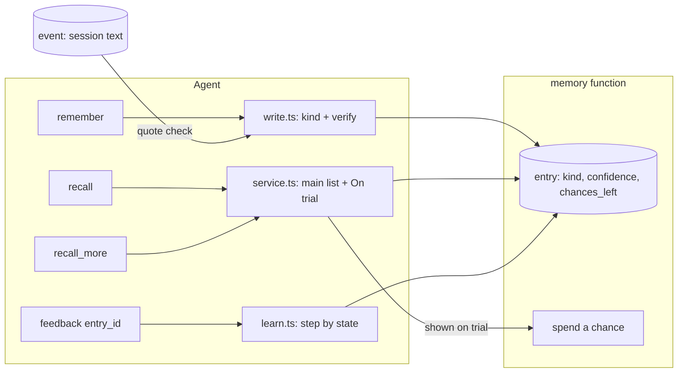

# memory's model: kinds, trials, and digging deeper

The plan for R27 (#20), R28 (#32), R29 (#33), R15 (#18) and R16 (#19). Their acceptance criteria are the contract, so this file carries only the design that the criteria don't.

## Intent

Today memory gates visibility on review. Every agent note is a `draft` in a `run:` scope, which plain recall never searches, so a checkable fact like "heyclyde.me was bought on Cloudflare" stays invisible. Confidence starts at 0.7 for every new entry, and nothing reads agent feedback.

After this change, every note is visible the moment it's written. Its strength comes from its evidence, and its first 3 showings decide whether it climbs, stays lukewarm, or fades.

**Before.** Codex on Wen's other Mac recalls "memory domain" and gets nothing. The note exists, but it's a draft in `run:memory-supabase-2026-11`.

**After.** The same recall returns it at once in the On trial list, as an observation at 0.5. Codex marks it helpful, and after 3 helpful chances it sits in the main list at about 0.86. A note citing the session event that shows `dig` resolving is a verified fact at 0.9, in the main list from the start.

## L1

The parts are:

- **Write.** remember takes an optional `evidence_event` (an event id) and `kind`. A quote in `evidence` that appears word for word in that event's payload makes the note a verified `fact`. The groom API already does this check (`admin.ts`, groom draft). A claimed fact that fails the check is stored as an `observation`. Notes without a run scope go to `global`. `project` is optional and defaults to the agent's own notes project.
- **Recall.** The main list ranks as today, over settled entries only, meaning `chances_left = 0`. The On trial list holds up to 3 entries with `chances_left > 0`, ranked by the same arm above a relevance floor, and shows each one's kind, strength and chances left. Showing a trial entry spends one chance. Dormant entries (below 0.15) appear in neither list.
- **Recall more.** `recall_more(retrieval_id)` returns ranks past the main list's cut, including dormant and superseded entries, labelled with their state.
- **Learn.** One function, `step(entry, outcome)`, moves confidence by 0.12 while an entry is in trial and by 0.02 once it's settled, clamped to [0.01, 0.99]. The step sizes are tunable on the eval. The outcome sources are Wen's pushback (the learner), per-entry agent feedback, and a get_entry open. A chance with no outcome changes nothing.

## Starting strength

| kind | how it's set | confidence | chances |
|---|---|---|---|
| fact | its evidence quote checks out against a cited event | 0.9 | 0 |
| wen | Wen's own words: evidence_kind quote, or groom drafts | 0.7 | 3 |
| observation | everything else an agent writes, and any fact that fails the check | 0.5 | 3 |
| plan | kind plan | 0.5 | 3 |

Existing entries migrate settled (`chances_left = 0`), with kind derived from pattern and evidence_kind. Their confidence stays as it is.

## Evidence

- **For a trial lane.** Bandit-style exploration of new memories, through UCB or Thompson sampling over memory utility, is the common pattern in 2026 agent-memory work ([MemCon](https://arxiv.org/abs/2607.13591), [Towards Autonomous Memory Agents](https://www.alphaxiv.org/abs/2602.22406)). A fixed 3-chance lane is the simplest version of that: exposure without a learned policy.
- **For a plastic window.** Reconsolidation research describes a retrieved trace as labile for a window, when it can be strengthened or weakened, and then restabilizing ([J Neurosci 2011](https://pmc.ncbi.nlm.nih.gov/articles/PMC3069643), [NCBI](https://ncbi.nlm.nih.gov/sites/books/NBK3905)). That's an analogy, not a spec.
- **Against.** Those bandit papers evaluate on proxy feedback, and RSCB-MC says so plainly ([arXiv 2604.27283](https://arxiv.org/pdf/2604.27283)). A trial window amplifies whatever signal it gets, so per-entry feedback and Wen's pushback have to carry it, and an agent's own "helpful" counts least. The research on whether retrieval strengthens or weakens is unsettled, so the step sizes stay tunable.
- **Client refresh (R31).** `tools/list_changed` exists, but Claude Code doesn't act on it mid-session ([Cursor forum](https://forum.cursor.com/t/mcp-notifications-tools-list-changed-not-acted-on-mid-session/161459)). memory is stateless and can't push anyway, so the version goes out at initialize, and hooks self-update.

## Shed and defer

- **Shed.** Verifying commits through the GitHub API. git output lands in session events (PostToolUse), so one quote check covers both, without a GitHub token in the function.
- **Defer.** A learned exploration policy (Thompson sampling), until 3 fixed chances prove too blunt on the eval. Also per-tenant step sizes, which come with R25.

## Slices

Each slice lands on main only with its criteria passing in CI (tier 3) or on the e2e branch bed (R30), and with R11's train eval at or above its thresholds.

1. **Kinds and starting strength (R27, R15).** Migration: `entry.kind`, `entry.chances_left`, `entry.evidence_event`. write.ts sets kind and confidence and verifies the quote. Agent notes default to global scope with an optional project. The packet shows kind. Tests first: a verified fact, a failed fact, and unscoped visibility.
2. **Two lists and chances (R28).** service.ts and search.ts split the packet, show On trial, and spend chances. learn.ts gets `step()`, and feedback with entry_id moves confidence. The R28 tests, then the eval.
3. **Recall more (R29).** The MCP tool, packet paging past the cut, and dormant entries labelled.
4. **Writing by default (R16).** Server instructions plus a Stop hook that asks for a remember when the session committed, deployed or decided something. remember needs only pattern, title, body and evidence.
5. **Self-updating clients (R31).** A server version, client-version headers on hooks, and the hook's background self-update.

Slices 1 to 3 touch the same files, so they run in order. Slice 5 is independent and can run beside them. Slice 4 follows slice 1.
