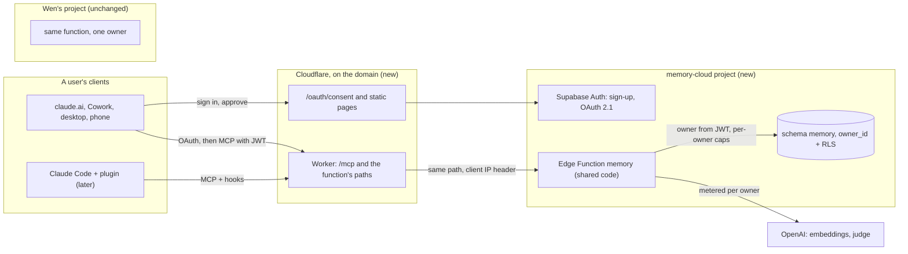

# memory as a product

Status: plan, 2026-11-01. Nothing here is built. Five decisions wait on Wen, listed under Decide first.

## Summary

Turns memory into something a stranger can add to Claude by pasting one URL. It ships first as a claude.ai custom connector, so it works in chats, Cowork, the desktop app, the phone and Claude Code. A Claude Code plugin that adds the hooks comes second.

The product runs in a new Supabase project, apart from Wen's. Both deploy the same function code, so every tenant fix lands for Wen too. Wen's own store, his experiments and his agents' routes stay in his project and never share a database with strangers.

The hard finding first: Anthropic's [Software Directory Policy](https://support.claude.com/en/articles/13145358-anthropic-software-directory-policy) rule 1.G says software "must not persistently store or use conversation content to build user profiles or attempt to make any changes to Claude's behavior across sessions." A memory service is exactly that. So the plan doesn't depend on the directory. Strangers add memory by URL as a custom connector, which every plan allows, Free users once.

## Intent

Today one person, Wen, can use memory. After this lands, anyone who signs up and clears the waitlist can connect memory to their Claude account, and their notes follow them across every Claude surface.

- **Before.** A friend asks for memory. Wen adds their email to `memory.allowed_email`, creates their Supabase user by hand, and their notes land in Wen's own database beside his work and personal entries.
- **After.** The friend opens claude.ai, adds a custom connector with `https://<domain>/mcp`, signs up on a real consent page, and lands on the waitlist. Wen approves them with one admin call. Their next chat recalls only their own notes, from a database Wen's personal entries were never in.

Who gains: Claude users who want memory they own, can export, and can reach from Claude Code and Codex too. Who loses: nobody today, since Wen's project only gains the tenant column. What Wen owns after: a second Supabase project at $25 a month or more, a domain, a privacy policy, a support inbox, and waitlist approvals.

Success is observable as three things. A waitlisted stranger connects claude.ai and recalls a note they wrote on the phone. A second stranger can't read the first one's notes through any route, tested. One tenant's OpenAI spend stops at its cap while the others keep working.

## Non-goals

- **Teams and sharing.** One account owns one store. No shared spaces in v1.
- **Self-hosting for customers.** The open-source repo already covers that.
- **ChatGPT, Gemini or other hosts.** Any MCP client with OAuth may work, but nothing is tested or promised.
- **The always-on box.** That's Wen's own path in `SUPABASE-PLAN.md`, not the product's.

## Decide first

The plan's one checkpoint. Each row is a recommendation until Wen rules.

| # | Decision | Recommendation | The alternative and its cost |
|---|---|---|---|
| D1 | Where strangers' data lives | A new Supabase project, `memory-cloud`, in its own Pro organization. Same code as Wen's | One project with an owner column. $25 a month cheaper, but a single bad policy or a leaked service key exposes Wen's work and personal entries to strangers |
| D2 | How tenants split inside it | `owner_id` on every table plus RLS, enforced by the function dropping to a non-bypass role per request | Schema per tenant. Stronger walls, but every migration runs N times, pg_cron needs N jobs, and `supabase db push` can't create schemas on demand |
| D3 | The public URL and consent page | A domain on Cloudflare, about $10 a year. Static pages and the consent page on Cloudflare, `/mcp` proxied to the function. See The domain | A Supabase custom domain, $10 a month. No proxy in the path, but Auth's issuer stays on `supabase.co` anyway, and Supabase says custom domains aren't for hosting frontends |
| D4 | Pricing | Free beta behind the waitlist with hard caps. A paid tier at about $6 a month only once 30 people use it weekly | Charge from day one. Needs a merchant of record, tax handling and refunds before anyone has proven they want it |
| D5 | The directory | Email mcp-review@anthropic.com about rule 1.G before any directory-only work. Ship by URL either way | Submit and see. A rejection costs nothing, but the review asks for neutral tool text and annotations that the connector should have anyway |

D3 is the one-way door. The first stranger who connects pins the URL, so it's settled before slice 4.

## Evidence

- **Against: the directory policy.** Rule 1.G, quoted above, reads directly on a memory service. Rule 1.E says software "must not collect extraneous conversation data, even for logging purposes." Nothing in the [review criteria](https://claude.com/docs/connectors/building/review-criteria) carves out user-consented memory. My inference: a directory listing is unlikely, and only Anthropic can say for sure.
- **For: custom connectors need no review.** Anthropic's [connector guide](https://support.claude.com/en/articles/11175166-get-started-with-custom-connectors-using-remote-MCP) lists custom remote MCP connectors on Free, Pro, Max, Team and Enterprise, with Free limited to one. memory already works this way for Wen since commit cc73bd7.
- **Against: Claude has memory built in.** It reached the Free plan on 2026-03-02 with an import tool for ChatGPT and Gemini memories ([9to5Mac](https://9to5mac.com/2026/03/02/free-claude-users-can-now-use-memory-and-import-context-from-rivals/)). A product has to win on what Claude's own memory can't do: reaching Claude Code and Codex, export, links between notes, and learning from pushback.
- **Against: paid rivals exist.** Supermemory and Mem0 both run MCP memory with free tiers and paid plans from $19 a month, per [Toolradar](https://toolradar.com/compare/supermemory-vs-mem0) as of October 2026. Third-party figures, unverified at the source.
- **For: RLS on a shared schema is the common default.** Practitioner guides from [MakerKit](https://makerkit.dev/blog/tutorials/multi-tenant-saas-architecture) and [GuardLayer](https://www.guardlayer.io/blog/supabase-multi-tenant-rls) recommend it, and warn that one policy bug leaks everything. None is official Supabase guidance.
- **Against: RLS does nothing today.** The function connects as `postgres`, which has `rolbypassrls = true`, checked on the live project. RLS only becomes a second wall once the function switches to a role without it on every request.
- **For: the consent page is meant to be ours.** Supabase's [OAuth 2.1 server guide](https://supabase.com/docs/guides/auth/oauth-server/getting-started) sends users to your own page with an `authorization_id`, and supabase-js gives it `getAuthorizationDetails`, `approveAuthorization` and `denyAuthorization`. The feature is still beta.
- **Against: a Supabase custom domain doesn't buy much.** The [limits page](https://supabase.com/docs/guides/functions/limits) serves function HTML only on custom domains, but the [custom domains guide](https://supabase.com/docs/guides/platform/custom-domains) says they "are not intended to enable hosting of frontend applications through Edge Functions." The [MCP guide](https://supabase.com/docs/guides/ai-tools/byo-mcp) says Auth "keeps its issuer on the project domain" even with one active.
- **For: filtered vector search works on this pgvector.** The live project runs pgvector 0.8.2, which has `hnsw.iterative_scan`, so a `where owner_id = …` filter keeps returning 50 candidates ([pgEdge docs](https://docs.pgedge.com/pgvector/v0-8-5/iterative-index-scans/)). Without it, a selective filter returns far fewer rows than the limit ([Crunchy Data](https://www.crunchydata.com/blog/hybrid-vector-search)).
- **For: plugins bundle hooks and MCP.** A Claude Code plugin carries `.mcp.json` and `hooks/hooks.json` at its root ([plugins reference](https://docs.claude.com/en/docs/claude-code/plugins-reference)).

## L1

The new parts are the second project, the domain with its proxy and consent page, sign-up with a waitlist, the owner column with RLS, and per-owner metering. The function, its tools, redaction and the judge are the code Wen runs today. Wen's project takes the same function and migration, with every row owned by him.

## Build now

- **Tenancy.** `owner_id uuid` on every per-user table, a composite key where ids were global, RLS on every table, and the function running each request as role `memory_tenant` with the owner set.
- **Accounts.** Sign-ups on, `memory.account` with a status, a waitlist, and an admin call to approve.
- **The domain.** The connector URL, the consent page, the legal pages and sign-in email, all on one domain Wen owns.
- **The consent page.** A static page on the domain: sign in or sign up, then a page naming the client and where it sends you, with Approve and Deny.
- **Per-owner metering.** OpenAI spend in dollars per owner per month, a cap per owner, and a project-wide ceiling.
- **Abuse limits.** Per-owner quotas on entries, recalls, writes and bytes, CAPTCHA on sign-up, and lockouts that already exist.
- **Account controls.** Export everything and delete everything, by the user, from MCP or the account page.
- **Generic text.** Every "Wen" in prompts, tool text and server instructions becomes "the user", and the server instructions stop telling Claude when to call tools.
- **Legal pages.** A privacy policy that names OpenAI and Supabase as processors, and terms.

## Shed

- **The email-link consent flow for strangers.** `oauth.ts`'s emailed link, `/oauth/wait` polling and its 3-emails cap go in `memory-cloud`. Wen's project keeps them until he moves it onto the domain too.
- **`memory.allowed_email` in `memory-cloud`.** `account.status` replaces it. Wen's project keeps its allowlist.
- **The arm experiment for strangers.** `memory-cloud` serves one arm, set by `MEMORY_ARMS`. Random arms per session confuse support and nobody's labeling strangers' recalls.
- **The device-token installer for strangers in v1.** Connector users need no token. The plugin brings it back in slice 9.

## Defer

| Item | Trigger | Cost of waiting |
|---|---|---|
| Billing | 30 weekly active users, or OpenAI spend over $40 a month | Beta users pay nothing. Caps hold the bill |
| Directory listing | Anthropic answers yes on rule 1.G | Discovery stays word of mouth |
| The learner for strangers | The plugin ships, since only hooks see the prompt after a recall | Chats learn nothing from pushback. Confidence moves only through feedback() |
| The daily groom for strangers | A user asks, and the plugin ships | Notes come only from `remember` |
| The inbox between a user's agents | A user runs more than one agent at once | `check_messages` and `post_message` stay off in `memory-cloud` |
| Point-in-time recovery | 100 users, or one lost day would hurt someone | Pro's daily backups only |
| Sign-in with Google | Email sign-up costs or bounces hurt | Email codes only |

## Stays Wen-only

| Piece | Why |
|---|---|
| His project, `wlhlncmgjqyidosunugv`, and every row in it | Work and personal life in one store. It never shares a database with strangers |
| clyde-flow's runtime token and its routes, `/entries` and `/recall` | Runs his own daemon. Strangers have none |
| The admin token, the console API and the backup token | `memory-cloud` gets its own admin token, held by Wen, scoped to accounts and caps |
| The arm experiment, the eval sets and the ant trainer | Measured on his labeled questions only |
| The groom and the learner's pushback reading | Read his prompts. They come to strangers only through the plugin, and only on opt-in |
| `confidential` sensitivity for work material | His work rule. Strangers get `normal` and `private` |
| The nightly GitHub export | `memory-cloud` relies on Pro backups. Strangers' data never lands in Wen's GitHub |

## L2: tenancy

**Owner.** Every row a user creates carries `owner_id uuid not null references auth.users(id)`. That covers `entry`, `link`, `blob`, `entry_blob`, `entry_embedding`, `source`, `mcp_session`, `mcp_client`, `retrieval`, `event`, `feedback`, `message`, `device`, `confidence_log` and `admin_audit`. Shared tables stay without it: `link_type_weight`, `auth_miss`, `setting`, `question` and `qrel`.

**Keys.** `entry.id` is free text today, like `proj-pkg`, so two users would collide. It becomes `primary key (owner_id, id)`, and `link`, `entry_blob` and `entry_embedding` reference `(owner_id, id)`. `blob.sha256` is content-addressed today, so one user could learn another holds a file by storing it. It becomes `primary key (owner_id, sha256)`.

**The role.** The function opens each request's transaction with `set local role memory_tenant` and `select set_config('memory.owner', $owner, true)`. `memory_tenant` has no `bypassrls`, and every policy reads `owner_id = current_setting('memory.owner')::uuid`. Cron and admin paths keep `postgres`, named in one place in `db.ts`. A query that forgets the owner filter returns nothing, rather than another user's rows.

**Vectors.** Recall's KNN in `search.ts` adds the owner filter and sets `hnsw.iterative_scan = relaxed_order` for the transaction. One HNSW index stays. Per-owner partial indexes wait until one owner's recall passes 300 ms at P95.

**Wen's project.** Takes the same migration. A default fills `owner_id` with Wen's auth user for every existing row, set once and then dropped.

## L2: accounts and sign-in

**Sign-up.** `enable_signup = true` in `memory-cloud`. Email one-time codes through custom SMTP, since Supabase's built-in email only reaches organization members. Turnstile CAPTCHA on sign-up, which Supabase Auth supports.

**Account.** `memory.account (owner_id, status, plan, created_at, approved_at)`. A trigger on `auth.users` insert adds the row as `waitlisted`. `status` is `waitlisted`, `active` or `suspended`, as a check constraint. `auth.ts` resolves a JWT to its owner and refuses anything not `active` with a 403 that says where the user stands in line.

**Consent page.** `https://<domain>/oauth/consent` is one static HTML page with supabase-js, served by Cloudflare. Signed out, it shows email sign-in. Signed in, it calls `getAuthorizationDetails` and shows the client's name and its callback host. Approve is offered only when the callback is `https://claude.ai/api/mcp/auth_callback` or a loopback `/callback`, the exact callbacks Anthropic's [authentication docs](https://claude.com/docs/connectors/building/authentication) name. Anything else shows Deny only.

**The server-side wall.** A page check alone isn't enough, since someone could approve through the API. `auth.ts` also refuses a JWT whose `client_id` has a callback outside that list, read from Supabase Auth's client record. Which table or admin call holds the record is unverified, and slice 3 settles it.

**Approving the waitlist.** `POST /api/v1/accounts/<id>/approve` with `memory-cloud`'s admin token flips the status and emails the user. A board message tells Wen each new sign-up.

## L2: the domain

Wen will buy one domain for the product. It does four jobs:

- **A stable connector URL.** Users paste `https://<domain>/mcp` once. Moving off Supabase later changes where the proxy points, not what anyone pasted.
- **Real HTML.** The consent page, sign-up, the landing page, privacy policy and terms. `supabase.co` rewrites function HTML to `text/plain`.
- **Sign-in email.** Custom SMTP sending from the domain. Supabase's built-in email reaches only organization members, about two an hour.
- **Trust.** The directory listing asks for a privacy policy URL, a documentation URL and a support contact. A domain's pages and `support@<domain>` read better than a `supabase.co` link and Gmail.

The two ways to wire it compare like this.

| | (a) Supabase custom domain | (b) Domain on Cloudflare |
|---|---|---|
| Cost | $10 a month add-on on a paid plan, plus the domain | About $10 a year at cost. Worker and static pages on free tiers |
| Connector URL | `https://api.<domain>/functions/v1/memory/mcp` | `https://<domain>/mcp` |
| OAuth issuer | Stays `https://<ref>.supabase.co/auth/v1`. Supabase's MCP guide says so, and the resource metadata must name that issuer or clients stop at discovery | The same |
| Consent page | Function HTML works, but Supabase says custom domains "are not intended" for frontends. A static host is still the right home | Static, on Cloudflare |
| In the request path | Nothing new | A Worker on every MCP call and hook. Its outbound fetch doesn't count against the 10 ms CPU limit |
| Limits | One custom domain per project, subdomains only | 100,000 Worker requests a day free. Static asset requests are free |
| Leaving Supabase | Repoint the CNAME, and the new host must answer on `/functions/v1/memory/...` | Change the Worker's upstream |
| Client IP for lockouts | `x-forwarded-for` as today | The Worker passes `cf-connecting-ip` in a header the function trusts only with a shared secret |

The brief assumed (a) moves the OAuth issuer onto the domain. Supabase's [MCP guide](https://supabase.com/docs/guides/ai-tools/byo-mcp) says it doesn't, so both options leave the issuer on `supabase.co` and leaving Supabase Auth means users sign in again either way. With that difference gone, (a) buys a path without a proxy for $120 a year, and still needs a static host for the pages.

**Recommendation: (b).** One Cloudflare Worker with static assets serves the site and the consent page and proxies the function's paths. The 100,000-request free cap holds until about 1,000 users running hooks. Past that, Workers Paid is $5 a month.

Once Wen has bought the domain, in this order:

1. **Register on Cloudflare.** Its registrar charges cost and puts DNS on Cloudflare in the same step.
2. **Inbound mail.** Cloudflare Email Routing forwards `support@<domain>` to Wen's Gmail, free.
3. **Outbound mail.** Add `send.<domain>` in Resend and copy its SPF and DKIM records into Cloudflare DNS. A subdomain keeps Resend's MX record apart from Email Routing's. Add a `_dmarc` TXT record with `p=none` to start. Resend's free plan sends 3,000 a month, 100 a day.
4. **SMTP in Supabase.** In `memory-cloud`'s Auth settings: host `smtp.resend.com`, port 465, user `resend`, the Resend API key as password, sender `memory@send.<domain>`. Then raise Auth's email rate limit, which custom SMTP unlocks.
5. **The Worker.** Static files for `/`, `/privacy`, `/terms` and `/oauth/consent`. Every other path, `/mcp`, `/.well-known/*`, `/install*`, `/hooks/*` and the rest, goes to `https://<ref>.supabase.co/functions/v1/memory` plus the same path, body streamed, with the client IP and the shared secret in headers. Attach it to `<domain>`.
6. **`config.toml` for `memory-cloud`.** `site_url = "https://<domain>"`, so Supabase sends consent to `https://<domain>/oauth/consent`. `additional_redirect_urls` gains `https://<domain>/**`. `enable_signup = true`. Today's `config.toml` is Wen's project's, so `memory-cloud` gets its own.
7. **The function.** A new secret, `MEMORY_PUBLIC_URL=https://<domain>`. `BASE()` in `oauth.ts` reads it, so `resourceMetadata()` names `https://<domain>/mcp` as the resource. `AUTH()` keeps `SUPABASE_URL`, which is the issuer. `clientKey()` in `auth.ts` takes the Worker's IP header only when the secret matches.
8. **Check discovery.** `authorization_servers` from `https://<domain>/.well-known/oauth-protected-resource` has to equal `issuer` from `https://<ref>.supabase.co/auth/v1/.well-known/oauth-authorization-server`. Then add `https://<domain>/mcp` as a connector in claude.ai and recall.

Wen's project stays on its `supabase.co` URL. Moving it onto the domain later means re-adding his connector once.

## L2: cost caps and screening

**Metering.** `memory.embed_usage (month, tokens)` counts embedding and judge tokens together against one $5 cap, at the embedding price. It becomes `memory.usage (owner_id, month, kind, tokens, micro_usd)`, with `kind` one of `embed`, `screen`, `relevance` or `reaction`. Each model's price lives in `config.ts`, so a price change is one line.

**Caps.** `budget()` in `embed.ts` takes the owner and checks two things: the owner's month against their plan's cap, and the project's month against a ceiling in `memory.setting`. Either one spent throws `OverBudget`.

**Over the cap.** Behavior stays what it is today, now per owner. Writes refuse, since `screen()` fails closed, and the refusal says the month's limit is reached and when it resets. Recall serves keyword ranks with no relevance filter. Nothing else stops.

**Screening.** `redact.ts` runs unchanged on every write. `judge.ts` keeps its three questions, but the `sensitive_pii` question refuses a user's own health details today. For strangers, a note about the author marked `private` passes, since it reaches OpenAI by title only. The `PUSHBACK` and `CAUSE` prompts say "the user" rather than "Wen".

**Rough cost.** A heavy user runs about 1,500 recalls a month. The relevance filter costs about $2 per 10,000 recalls, per `DEPLOY.md`, so $0.30. Writes, embeddings and the learner add less than that. Call it under $1 a heavy user a month. Wen's own month is the check once his first full month lands.

## L2: abuse limits

| Limit | Free beta | Why |
|---|---|---|
| Entries | 2,000 | Wen has 464 |
| Blob bytes | 50 MB total, 1 MB each | Stops file hosting |
| Recalls | 3,000 a month, 30 a minute | Covers a heavy user twice |
| Writes | 300 a day | A runaway agent loop stops in minutes |
| Hook events | 2,000 a day, metadata-only by default | Hooks write the most rows. Wen's run about 55 a day |
| OpenAI spend | $1 a month | The cap above, with room |
| Sign-ups | Supabase Auth's rate limits plus CAPTCHA | Bots |

Each limit returns 429 with the reset time. The counts sit in one place, `memory.plan_limit`, keyed by plan, so the paid tier is one row. Wrong-token lockouts in `auth.ts` stay as they are.

## L2: the plugin

A Claude Code plugin, `memory`, published from this repo's marketplace. `.mcp.json` points at `https://<domain>/mcp` as an HTTP server, and Claude Code signs in through the loopback OAuth flow, with no token to copy. `hooks/hooks.json` runs `memory-hook`, which needs a device token, since hooks can't use the MCP client's OAuth token. A `/memory:connect` command runs the existing `/install` claim flow to mint one. Hooks default to `metadata`, and full prompts are an opt-in the user types.

## L3: slices

Each slice starts with a failing test against `memory-test`, the test project, and lands in this order.

| # | Slice | Depends on | Acceptance, failing first |
|---|---|---|---|
| 1 | Owner column, composite keys, `memory_tenant` role and RLS, migration only | none | Two owners write `proj-pkg` and both rows exist. A query as owner A in `memory_tenant` returns zero of B's rows. Fails today on the primary key |
| 2 | Function sets role and owner per request, recall's iterative scan | 1 | Every MCP tool called as owner A never returns B's entries, blobs, retrievals or messages. Hybrid holds 90% on train in Wen's data |
| 3 | `account` table, waitlist trigger, `auth.ts` gate, the client callback wall | 2 | A waitlisted user's JWT gets 403. A JWT from a client with an off-list callback gets 401 |
| 4 | `memory-cloud` project, the domain, the Worker proxy, custom SMTP, Turnstile, steps 1 to 8 of L2: the domain | D1, D3 | `https://<domain>/healthz` answers through the Worker. The resource metadata's issuer matches Auth's. A sign-up email arrives at an address outside the organization. Ten wrong tokens from one address lock out that address, not the Worker's |
| 5 | The consent page | 3, 4 | Adding the connector in claude.ai shows the page, sign-up waitlists, approval connects, and recall answers |
| 6 | Per-owner metering, caps and quotas | 2 | Owner A at their cap gets the limit message on `remember` while owner B's write succeeds |
| 7 | Generic text, tool annotations, export and delete | 2 | `tools/list` names no person and every tool has a `title` and a read-only or destructive hint. Delete leaves zero rows for the owner |
| 8 | Privacy policy, terms, landing page with the connector URL | 4 | Pages live on the domain |
| 9 | The plugin | 5 | A fresh Claude Code installs it, signs in, and its next prompt logs a metadata event |
| 10 | Wen's project takes slices 1 to 3 and 6 | 2, 3, 6 | Every row has Wen's owner. His recall, hooks and clyde routes still pass |

Slices 1 to 3 change shared code and land on Wen's project only in slice 10, after strangers' beta proves them. Slices 6 to 8 run beside 5.

## Rollout

| Stage | Who | Advance when | Stop when |
|---|---|---|---|
| 1 | Wen, on a second account | Slices 1 to 7 pass, and his test account can't see his first | Any cross-owner read |
| 2 | Five people Wen approves by hand | A week with no cross-owner read and spend under $5 | Any leak, or a cap that fails open |
| 3 | The waitlist, 20 a week | 30 weekly active users | Support load Wen won't carry |
| 4 | Billing, then open sign-up | D4's trigger | |

No feature flag. `account.status` already gates every request, and setting `signups_open = false` in `memory.setting` closes the door without a deploy. Proposed, pending Wen. What it can't undo: notes already stored, which only the user's delete removes.

## Checks before handoff

- **Owners.** `auth.ts` owns who, `db.ts` owns the role switch, `embed.ts` owns spend. Nothing else reads `memory.owner`.
- **Failure.** A missing owner setting fails closed, since RLS returns nothing. A judge outage refuses writes and leaves recall unfiltered, as today.
- **States.** `account.status` and `usage.kind` are check constraints, so a new value is a migration.
- **One rule, one place.** Allowed callbacks live in one list shared by the page and `auth.ts`. Limits live in `memory.plan_limit`.
- **Compatibility.** Wen's connectors keep the old URL on his project. Strangers only ever see the domain.

## Open

- **Rule 1.G.** Ask mcp-review@anthropic.com whether a user-owned memory connector can be listed. Wen sends it.
- **OpenAI as a processor.** The directory's data step asks whose APIs a server calls. Rule 3.F wants endpoints you own or legitimately proxy. Unclear for an LLM provider. The local-model path in `SUPABASE-PLAN.md` removes the question.
- **Where users live.** `memory-cloud` sits in Canada like Wen's. EU users bring GDPR duties the privacy policy has to meet before stage 3.
- **Supabase's OAuth server is beta.** A breaking change would stop sign-ins until fixed. Free during beta, pricing unannounced.
- **Purchases.** The Pro organization and the domain are Wen's to buy. Resend, Cloudflare's Worker and Email Routing start free.

## Sources

- [Anthropic Software Directory Policy](https://support.claude.com/en/articles/13145358-anthropic-software-directory-policy)
- [Connector review criteria](https://claude.com/docs/connectors/building/review-criteria)
- [Connector submission](https://claude.com/docs/connectors/building/submission)
- [Connector authentication](https://claude.com/docs/connectors/building/authentication)
- [Custom connectors on claude.ai](https://support.claude.com/en/articles/11175166-get-started-with-custom-connectors-using-remote-MCP)
- [Supabase OAuth 2.1 server](https://supabase.com/docs/guides/auth/oauth-server/getting-started)
- [Supabase Edge Function limits](https://supabase.com/docs/guides/functions/limits)
- [Supabase custom domains](https://supabase.com/docs/guides/platform/custom-domains)
- [Supabase MCP servers, custom domain section](https://supabase.com/docs/guides/ai-tools/byo-mcp)
- [Cloudflare Workers limits](https://developers.cloudflare.com/workers/platform/limits)
- [Supabase pricing](https://supabase.com/pricing)
- [pgvector iterative scans](https://docs.pgedge.com/pgvector/v0-8-5/iterative-index-scans/)
- [Claude Code plugins reference](https://docs.claude.com/en/docs/claude-code/plugins-reference)
- [SUPABASE-PLAN.md](SUPABASE-PLAN.md) and [DEPLOY.md](DEPLOY.md)
