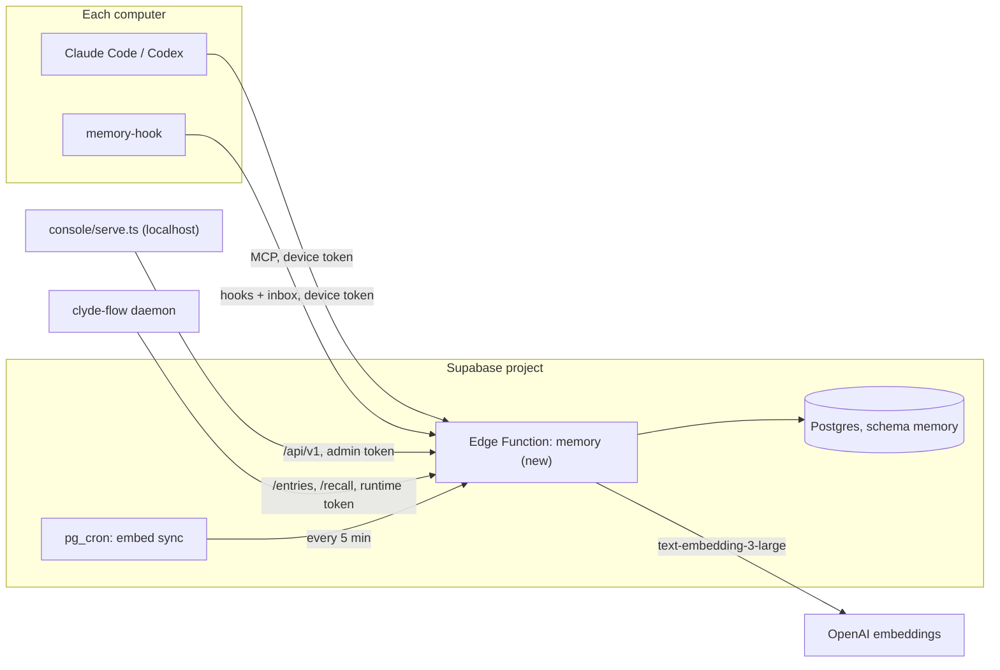

# Memory on Supabase

Status: live, 2026-11-01. Project `memory` (ref `wlhlncmgjqyidosunugv`) serves every route, holds all 32,695 rows from the Droplet's dump, and this Mac is cut over. Waiting on a working OpenAI key for embeddings, and a host for the console.

## Summary

Moves memory off the DigitalOcean Droplet onto one Supabase project: Postgres for the store and one Edge Function for MCP, the hooks, clyde-flow's routes and the console API. Adding a computer becomes one command plus a token minted for that computer. Wen is the only user, and every choice below keeps a path open to many users without building for them now.

## What's new

- **`memory` MCP server.** Was `kb`. Tools become `mcp__memory__recall` and so on.
- **`https://<ref>.supabase.co/functions/v1/memory`.** The one URL. It never changes when the database moves or grows.
- **Per-computer tokens.** `POST /api/v1/devices` mints one, shown once. Revoke one without touching the rest.
- **`memory/hooks/install.sh`.** Takes no IP and needs no SSH. Asks for the computer's token with input hidden.
- **`memory/console/serve.ts`.** Runs the console on localhost, since Supabase won't serve HTML without a custom domain.
- **Schema `memory`.** Every table, out of PostgREST's reach.
- **Removed `memory/deploy/`.** Droplet provisioning, compose, Caddy, Ollama and restic go.

## L1

Every caller reaches one Edge Function, and it alone touches the database. The function, the schema, the cron job and per-computer tokens are new. The Droplet, Caddy, Ollama and restic are gone.

## Decisions

| # | Decision | Ruling | Why |
|---|---|---|---|
| 1 | Name | `memory`, replacing `kb` everywhere | Wen, 2026-11-01. Matches the folder, the README and the harness's memory contract |
| 2 | Host | One Supabase project, schema `memory`, one Edge Function | Wen picked Supabase. One function keeps one auth gate |
| 3 | Plan | Free, $0 | Wen, 2026-11-01. A nightly GitHub Action export stands in for platform backups |
| 4 | Embeddings | OpenAI `text-embedding-3-large` at 1024 dimensions | The key exists, no new account. bge-m3 needs Ollama or a new provider |
| 5 | 中文 search | PGroonga with TokenBigram and NFKC | Supabase has no pg_jieba. Bigrams are the standard CJK approach, and multilingual embeddings carry 中文 questions to English entries |
| 6 | Console | Not hosted yet | Wen wants no local piece and no custom domain. Storage serves HTML as sandboxed text/plain, and Edge Functions need a custom domain for HTML |
| 7 | Computers | One token per computer, revocable | A lost laptop costs one revoke, not a rotation everywhere |
| 8 | MCP transport | Hand-written stateless JSON-RPC, our own `Mcp-Session-Id` | Arms are drawn per session. The SDK's stateless mode issues no session id, and its stateful mode keeps sessions in one isolate's memory |
| 9 | Data path | Export and import through the function, paged | The CLI's keychain token stays out of scripts. A streamed export got cut off mid-table, so pages keep each request inside the function's limits |

## Evidence

- **For: MCP on Edge Functions is a supported path.** Supabase's [Deploy MCP servers](https://supabase.com/docs/guides/ai-tools/byo-mcp) guide runs the MCP SDK's streamable HTTP transport on Hono, deployed with `--no-verify-jwt`. [mcp-lite](https://supabase.com/docs/guides/functions/examples/mcp-server-mcp-lite) is a second option.
- **Against: the guide covers unauthenticated servers only.** Auth is ours to write, which the function's bearer check already is.
- **Against: no HTML.** [Limits](https://supabase.com/docs/guides/functions/limits) says HTML needs a custom domain, and the [debugging page](https://supabase.co/docs/guides/functions/debugging) says `text/html` is rewritten to `text/plain`. That's why the console runs locally.
- **For: limits fit.** 2 s of CPU per request with async I/O excluded, 256 MB, 150 s wall clock on Free and 400 s on paid. A recall is one embedding call and four queries.
- **For: cold starts fit the hook's 3 s timeout.** Supabase reported a 42 ms average and under 500 ms at P99 in July 2025, relayed by [a third party](https://joshuaberkowitz.us/blog/news-1/supabase-edge-functions-persistent-storage-and-lightning-fast-cold-starts-transform-serverless-workflows-563). Unverified at the source.
- **Against: shared platform incidents.** Edge Functions had elevated 503s for six hours on 2026-09-16. The hook fails silent, so an outage costs memory, not sessions.
- **For: a path to many users exists.** Supabase Auth runs an [OAuth 2.1 server with dynamic client registration for MCP](https://supabase.com/docs/guides/auth/oauth-server/mcp-authentication), public beta since November 2025.
- **Pricing.** Pro is $25 per organization with $10 of compute credit, enough for one Micro instance ([Supabase KB](https://supabase.com/kb/faqs/platform/database-only-cost)).

## Build now

- **The store.** Every table the Droplet had, in schema `memory`, loaded from the 2026-11-01 dump in `~/kb-backup`. Embeddings are rebuilt with the new model.
- **The function.** MCP's seven tools, the hooks, the inbox, clyde-flow's four routes, `/healthz`, the console API, and the embed sync.
- **Auth.** Device tokens and the runtime token for agent paths, the admin token for `/api/v1`, stored as SHA-256 only. Wrong-token lockouts kept in the database, since isolates come and go.
- **The installer.** One command per computer, Claude Code and Codex, macOS and Linux.
- **The rename.** `kb` to `memory` in code, config, docs, the hook and the clients' settings.
- **The eval.** `retrieval_eval.py` on train through `/api/v1/recall/preview`. Hybrid has to hold 90% on train with the new embeddings, or it's a question before cutover.

## Shed

- **Ollama and bge-m3.** OpenAI replaces them.
- **Caddy, sslip.io, restic, Spaces, provision.py, cloud-deploy.py.** Supabase covers TLS, the URL and backups.
- **The pytest suite.** The Python server goes, so its tests go. The contract tests move to Deno against a test project.
- **`KB_TOKEN_SHA256` and the plain-token options.** Every token is stored hashed, with no choice to make.

## Defer

| Item | Trigger | Cost of waiting |
|---|---|---|
| Custom domain for the console | Wen wants the console on his phone | $10 a month when it lands |
| OAuth sign-in for MCP clients | A second person uses it | Device tokens keep working beside it |
| Point-in-time recovery | A day of lost writes would hurt | Paid add-on, enable any time |
| Embed queue on pgmq | Embed sync takes over 60 s | None at 461 entries |

## Scale path

Built for one person, with each step to many users a change in one place.

1. **Many computers, one person (now).** A `device` table holds a token hash, a name, `last_seen` and `revoked_at`. Every agent request resolves to a device. This table is the seed of a principal.
2. **A few trusted people.** Add `owner` to `device`, then `owner_id` to `entry`, `kb_session`, `retrieval`, `event`, `message` and `feedback`. The function adds `owner_id = $principal` to every query. The arm experiment runs per owner. Auth stays in `auth.ts`, so it's one module and one migration.
3. **Strangers.** Swap device tokens for Supabase Auth's OAuth 2.1 server, so MCP clients sign in with dynamic client registration. Turn on RLS keyed on the token's `user_id` as a second wall behind the function's filter. Move the console to a static host with Supabase Auth login. Per-user OpenAI cost needs a rate limit per owner.
4. **Load.** Move embedding to a pgmq queue drained by cron. Partition `event` by month, since hooks write the most rows. Raise compute from Micro when P95 recall passes 300 ms. Add HNSW partial indexes per owner only when one owner's recalls slow another's.

Nothing in steps 2 to 4 is built now. The one step-1 piece that pays off today is the device table.

## L2

**Edge Function `memory`.** Routes by path after `/memory`. `auth.ts` resolves the bearer to a role (device, runtime or admin) or answers 401, 429 or 503. Then `mcp.ts`, `hooks`, the clyde routes or `api.ts` run with that role.

**MCP (`mcp.ts`).** Answers `initialize`, `tools/list`, `tools/call` and `ping` over POST, with JSON responses only. `initialize` mints `Mcp-Session-Id` and stores the client name in `mcp_client`, so later calls know claude from codex. GET answers 405, which the spec allows when a server offers no stream.

**Store (schema `memory`).** The Droplet's tables plus `device`, `mcp_client`, `auth_miss` and `setting`. The OpenAI key and the cron secret sit in Vault. `revoke all on schema memory` from `anon`, `authenticated` and `service_role`.

**Embed sync.** pg_cron posts to `/embeddings/sync` every 5 minutes with a Vault secret. A write answers before embedding, and keyword search finds it at once.

**Console launcher.** `deno run --allow-net --allow-read memory/console/serve.ts` serves the unchanged console files on `localhost:8787` and proxies `/api/v1` to the function. The admin token stays in the browser, as today.

**Installer.** Writes `~/.config/memory/{url,token,memory-hook}`, adds the MCP server at user scope in Claude Code and to `~/.codex/config.toml`, and merges the hooks. It removes the old `kb` entries.

## L3

### Slices

| # | Slice | Depends on | Acceptance |
|---|---|---|---|
| 1 | Migration, function skeleton, auth, device tokens, `/healthz` | none | Contract tests on the test project: a revoked token gets 401, the 11th wrong token gets 429, `anon` can't read `memory.entry` through PostgREST |
| 2 | MCP tools, hooks, inbox, clyde routes, embed sync | 1 | Claude Code's real client lists seven tools and runs `recall`. `remember` twice with one payload returns one id. Hook POST lands an event |
| 3 | Data import, re-embed, train eval | 2 | Row counts match the dump for every table. Hybrid holds 90% on train |
| 4 | Installer, rename, cutover on this Mac | 3 | A fresh shell's Claude Code session gets its inbox from `memory-hook` and recalls an entry |
| 5 | Console API and launcher | 1 | The console's overview, entries and recall preview load against the live function |
| 6 | Remove `memory/deploy/`, the Python server and pytest suite, update docs | 4, 5 | No reference to `kb`, Droplet or Ollama outside git history |

Slice 5 runs beside 2 to 4. Slices 1 to 4 are the critical path, since memory is offline until 4.

### Test project

Contract tests run against a second free Supabase project, `memory-test`, with the same migration. Each run truncates its tables first. Never against the live project.

### Rollout

No flag. The old server is gone, so there's nothing to fall back to. The dump in `~/kb-backup` is the rollback for data.

## Open

- **Supabase Pro.** Upgrading the organization is a purchase, so Wen clicks it.
- **Cron to function auth.** The cron job carries a Vault secret in its own SQL. Anyone with database access already has everything, so this adds no exposure.
